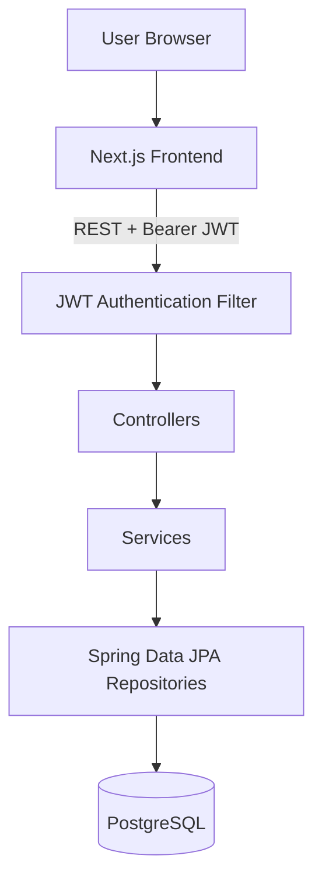
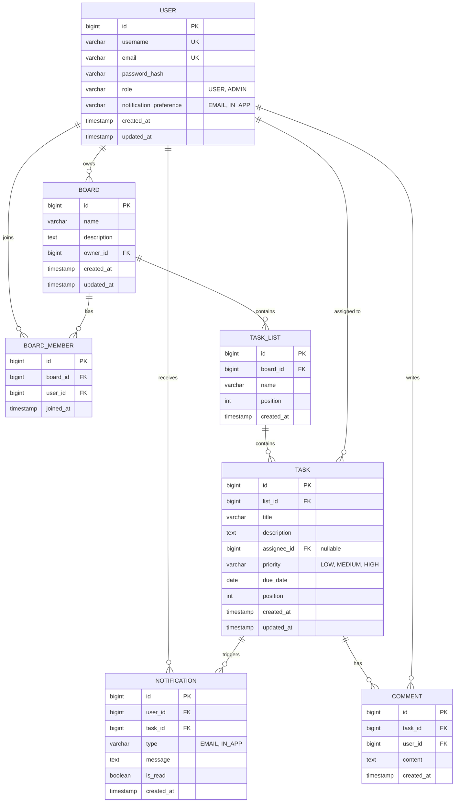

# Mini Trello — Task & Project Management System

> A Kanban-style collaboration platform built around nested relational data, board-scoped authorization, and stateless JWT authentication.

## Overview

Mini Trello covers the design, implementation, and operation of a multi-user task management system. The central challenge is modeling hierarchical data (Board → List → Task → Comment) across several users while keeping access control consistent at every level of the hierarchy.

The platform focuses on:

- Relational domain modeling with JPA/Hibernate, including a many-to-many board membership model.
- Stateless authentication and role-based authorization with Spring Security and JWT.
- Board-scoped access control for owners and members.
- Kanban workflows: ordered lists, ordered tasks, assignment, and moving tasks between lists.
- Notifications delivered through each user's preferred channel.
- A consistent validation and error contract shared by the REST API and the web client.

The backend is the primary focus of the project. The frontend is a lightweight Next.js client that consumes the API.

## Table of Contents

- [Overview](#overview)
- [Key Features](#key-features)
  - [For Users](#for-users)
  - [For Board Owners](#for-board-owners)
- [System Architecture](#system-architecture)
  - [Architecture Overview](#architecture-overview)
  - [Layer Responsibilities](#layer-responsibilities)
  - [Communication Patterns](#communication-patterns)
- [Database Design](#database-design)
- [Technology Stack](#technology-stack)
  - [Backend](#backend)
  - [Frontend](#frontend)
- [Security](#security)
- [Project Structure](#project-structure)
- [Quick Start](#quick-start)
  - [Prerequisites](#prerequisites)
  - [Clone the Repositories](#clone-the-repositories)
  - [Start PostgreSQL](#start-postgresql)
  - [Run the Backend](#run-the-backend)
  - [Run the Frontend](#run-the-frontend)
  - [Configuration](#configuration)

## Key Features

### For Users

- Account registration and login with JWT authentication.
- Create and manage boards.
- Organize work into lists (for example *To Do*, *In Progress*, *Done*).
- Create tasks with title, description, priority (`LOW`, `MEDIUM`, `HIGH`), and due date.
- Reorder lists and move tasks between lists.
- Assign tasks to board members.
- Comment on tasks and delete your own comments.
- Receive a notification when a task is assigned to you, through your preferred channel (`EMAIL` or `IN_APP`).
- In-app notification feed with read/unread state.

### For Board Owners

- Update or delete boards.
- Invite members by email and remove members.
- Delete lists.
- Full visibility into every list, task, and comment on the board.

## System Architecture

### Architecture Overview

Mini Trello is a layered backend serving a separately deployed web client. The backend owns all business rules and persistence; the frontend only calls the REST API.



### Layer Responsibilities

| Layer | Responsibility |
|---|---|
| Security | JWT validation and authenticated principal |
| Controller | HTTP mapping, request validation, response shaping |
| Service | Business rules, authorization checks, transactions |
| Repository | Persistence and queries through Spring Data JPA |
| Entity | JPA domain model and relationships |
| DTO | API request/response contracts, separate from entities |
| Exception | Custom exceptions mapped to a standard error response by `@ControllerAdvice` |

### Communication Patterns

| Interaction | Protocol | Reason |
|---|---|---|
| Frontend to Backend | REST (JSON) | Synchronous user-facing request/response |
| Authentication | `Authorization: Bearer <JWT>` | Stateless sessions, no server-side session store |
| Backend to PostgreSQL | JDBC via Hibernate | Transactional relational storage |

## Database Design



## Technology Stack

### Backend

- Java 17
- Spring Boot 3 (Spring Web)
- Spring Security with JWT
- Spring Data JPA / Hibernate
- PostgreSQL
- Bean Validation
- springdoc-openapi (Swagger UI)
- JUnit 5 and Mockito

### Frontend

- Next.js 14 (App Router) with TypeScript
- Tailwind CSS
- shadcn-style components on Radix UI primitives
- react-hook-form with Zod
- axios (JWT interceptor)
- sonner (toasts)

## Security

- JWT-based stateless authentication.
- Passwords hashed with BCrypt.
- Role-based access control (`USER` / `ADMIN`).
- Board-level permissions: owner-only operations are separated from member operations.
- Comment deletion restricted to the comment author.
- Request validation with Bean Validation on every write endpoint.
- Entities are never exposed directly; all responses go through DTOs.
- Secrets (database credentials, JWT signing key) are supplied through environment configuration and never committed.

## Project Structure

The project is split into two repositories:

- [`mini-trello-backend`](https://github.com/henrydaoo/mini-trello-backend) — REST API
- [`mini-trello-frontend`](https://github.com/henrydaoo/mini-trello-frontend) — web client

```text
mini-trello-backend/
├── src/
│   ├── main/
│   │   ├── java/.../
│   │   │   ├── controller/      REST controllers
│   │   │   ├── service/         Business rules and transactions
│   │   │   ├── repository/      Spring Data JPA repositories
│   │   │   ├── entity/          JPA entities
│   │   │   ├── dto/             Request and response models
│   │   │   ├── exception/       Custom exceptions and global handler
│   │   │   └── security/        JWT filter and security configuration
│   │   └── resources/           Application configuration
│   └── test/                    Tests
└── pom.xml

mini-trello-frontend/
├── src/
│   ├── app/                     Next.js App Router pages and layouts
│   ├── components/              UI components (components/ui: Radix-based primitives)
│   ├── hooks/                   Custom React hooks
│   └── lib/                     API client, validation schemas, utilities
├── tailwind.config.ts
└── package.json
```

## Quick Start

### Prerequisites

- Java 17+
- Maven
- Node.js 18+
- PostgreSQL 14+ (local install or Docker)
- Git

### Clone the Repositories

```bash
git clone https://github.com/henrydaoo/mini-trello-backend.git
git clone https://github.com/henrydaoo/mini-trello-frontend.git
```

### Start PostgreSQL

```bash
docker run --name mini-trello-db \
  -e POSTGRES_DB=mini_trello \
  -e POSTGRES_USER=postgres \
  -e POSTGRES_PASSWORD=postgres \
  -p 5432:5432 -d postgres:16
```

### Run the Backend

```bash
cd mini-trello-backend
# configure the datasource and JWT settings (see Configuration)
./mvnw spring-boot:run
```

### Run the Frontend

```bash
cd mini-trello-frontend
cp .env.example .env.local
# set the backend URL (see Configuration)
npm install
npm run dev
```

Services will be available at:

- Frontend: http://localhost:3000
- Backend API: http://localhost:8080
- Swagger UI: http://localhost:8080/swagger-ui.html

### Configuration

**Backend** (`application.properties` or environment variables)

```properties
spring.datasource.url=jdbc:postgresql://localhost:5432/mini_trello
spring.datasource.username=postgres
spring.datasource.password=postgres

app.jwt.secret=your_jwt_secret
app.jwt.expiration-ms=86400000
```

**Frontend** (`.env.local`)

```env
NEXT_PUBLIC_API_URL=http://localhost:8080
```
